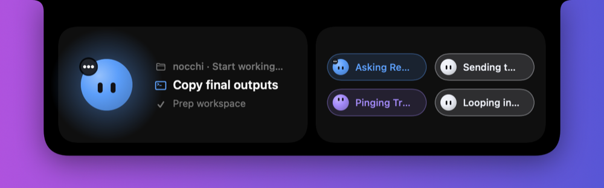
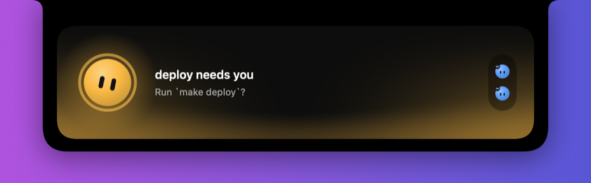

# Nocchi

A little face that lives in your Mac's notch and shows what your coding agents are doing. Claude
Code, Codex and anything else [Herdr](https://herdr.dev) runs get a face that works, thinks, waits
for you, celebrates when it's done and dozes off when idle. Collapsed, it hugs the notch; hover and
it springs open.





Concept, character and interaction design by AB Babaei (@ab.workss),
building on John Bai's original "bot in the notch" idea. Go check out their work.

## What it does

- **Collapsed:** the primary agent's face on the left of the notch, up to four others in a 2×2
  cluster on the right (a "+N" badge when there are more). No text: the faces do the talking.
- **Color means state:** idle white, thinking purple, working blue, needs you amber, done green,
  failed red, asleep gray.
- **Hover:** a focus card for the primary agent (its task, current step and previous step, or its
  last message), plus a chip for every other agent. Click a chip to make that agent the primary.
- **Peeks:** when an agent needs you, the notch opens by itself. A finished or failed turn shows a
  one-line banner under the notch instead. Turns that finish in the window you're looking at stay
  quiet.
- **Click the primary face** to jump to that agent's terminal window or tab. When it's idle, click
  it to write a message to it instead (Herdr agents).
- **Drop a folder on the notch** to start a new Claude agent there (Herdr).
- **A greeting** at launch: sparks, a wave hello, and a jump into the notch.

On screens without a notch, Nocchi draws one, and its middle shows short status messages ("deploy
needs you", "2 working · 1 needs you").

## Requirements

- macOS 15 (Sequoia) or later. Works with or without a hardware notch.
- Xcode 16 or the Swift 6 toolchain, to build it.
- At least one agent source:
  - **Claude Code:** nothing to set up. Nocchi reads Claude's own list of running sessions
    (`~/.claude/sessions`) and their transcripts, so sessions in any terminal or IDE show up.
  - **[Herdr](https://herdr.dev) 0.9.1 or later:** for Codex and every other agent Herdr
    recognizes, and for writing to agents and starting them from the notch.

## Install

There are no prebuilt downloads: build it from source.

```sh
git clone https://github.com/nicbet/nocchi.git
cd nocchi
make release                      # builds build/Nocchi.app
cp -R build/Nocchi.app /Applications/
open /Applications/Nocchi.app
```

Nocchi has no Dock icon; it lives in the notch and a menu-bar item. To start it with your Mac,
turn on **Launch at Login** in that menu.

The app is ad-hoc signed, not notarized. A copy you build yourself opens normally. If you copy the
app to another Mac, Gatekeeper blocks it the first time: right-click it and choose **Open**, or run
`xattr -dr com.apple.quarantine /Applications/Nocchi.app`.

### Optional: open the exact window

By default, opening an agent brings its terminal app to the front. To raise the exact window or tab
the agent runs in, choose **Open the Exact Window…** in the menu and grant Nocchi Accessibility
access in System Settings ▸ Privacy & Security ▸ Accessibility.

Because the app is ad-hoc signed, macOS treats every rebuild as a new app: after updating, remove
Nocchi from that list and grant access again.

## Settings

All in the menu-bar item:

| Setting | What it does |
|---|---|
| Peek | **Everything** (open for "needs you", banner for finished or failed), **Only When Needed**, or **Never** |
| Play Sounds | A short sound when an agent needs you, failed or finished |
| Show Status Text | Messages in the middle of a drawn notch (screens without a hardware notch) |
| Sources | Herdr and Claude Code, each on or off |
| Screen | Which display shows the notch (Automatic picks the one with a notch) |
| Ignore Reduce Motion | Keep the animations when Reduce Motion is on (if you use it only for faster Spaces) |
| Launch at Login | Start Nocchi when you log in |

To watch a named Herdr session or a socket somewhere else:

```sh
defaults write com.github.nicbet.nocchi herdrSession <name>
defaults write com.github.nicbet.nocchi herdrSocketPath <path>
```

**Demo** in the menu plays scripted scenarios with mock agents, to see every state without running
any.

## Development

```sh
make            # list the tasks
make dev        # rebuild a debug app and relaunch it
make test       # all tests (Herdr integration tests run when herdr is installed)
make snapshot   # render the notch in every state to build/snapshots/*.png
make live       # render the notch from your real Herdr
```

`make snapshot` renders offscreen, so it needs no Screen Recording permission. The Debug menu has
the mood gallery, a greeting replay and controls to keep the notch open.

The design, architecture and milestones are in [PLAN.md](PLAN.md).
